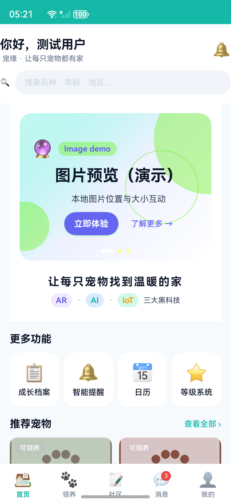
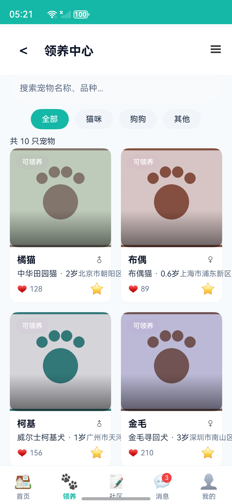
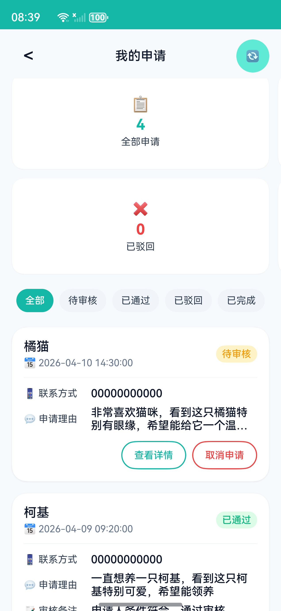
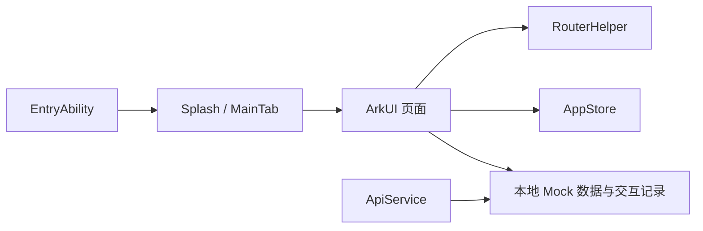

# 宠缘 · PetDestiny

**HarmonyOS 宠物领养与照护交互原型。** 使用 ArkTS、ArkUI 和 Stage 模型实现宠物浏览、详情、领养申请及社区等页面，以本地 Mock 数据演示业务流程。

**English:** PetDestiny is a HarmonyOS pet adoption and care prototype built with ArkTS, ArkUI, and the Stage model. Its current business flows use local mock data; AI, AR, and IoT screens are demonstrations rather than production integrations.

项目由作者独立开发。它面向作品展示和源码讨论，尚未接入真实领养机构、服务端账户体系、AI 模型、AR 引擎或物联网设备，也没有真实商业用户数据。示例联系方式已改为无效号码和 `example.com` 邮箱，不可用于实际联系。

## 技术栈与工程

| 项目 | 源码依据 |
| --- | --- |
| HarmonyOS / Stage 模型 | [`entry/build-profile.json5`](entry/build-profile.json5)、[`entry/src/main/module.json5`](entry/src/main/module.json5) |
| ArkTS / ArkUI | [`entry/src/main/ets/pages/`](entry/src/main/ets/pages/) |
| 目标与兼容 SDK `6.0.2(22)` | [`build-profile.json5`](build-profile.json5) |
| 单 `entry` 模块，手机设备 | [`build-profile.json5`](build-profile.json5)、[`entry/src/main/module.json5`](entry/src/main/module.json5) |
| 本地 Mock 数据与内存状态 | [`entry/src/main/ets/mock/`](entry/src/main/ets/mock/)、[`AppStore.ets`](entry/src/main/ets/store/AppStore.ets) |

## 功能现状

以下状态已有 2026-10-15 在 OpenHarmony 6.0.2.130 模拟器上的安装启动与页面检查作为依据，
安装的是未签名 HAP；数据仍是内存 Mock，不是物理真机、线上后端或跨重启持久化证据。

| 模块 | 当前状态 | 边界 |
| --- | --- | --- |
| 首页、宠物列表、详情 | 模拟器已检查首页、列表筛选/导航、详情展示 | 宠物来自 `mock/PetData.ets` |
| 登录、领养申请 | 模拟器已检查：无效手机号 `00000000000` 被拦截；演示号码 `13800000000` 下两个居住选项可从“否”切成“是”并在滚动后保持，提交后出现成功反馈，返回详情后“我的申请”新增第 4 条待审核 Mock 记录 | 无真实身份认证、提交接口或服务端保存；申请数仅内存 Mock |
| 收藏 | 模拟器已复测收藏/取消，个人中心计数 2→1→2 通过；自动化业务测试见下文 | 内存 Mock 状态，应用重启后不能保证保留 |
| 社区、消息、个人中心 | 模拟器已检查社区和个人中心；个人中心申请数和“我的申请”统计卡均从 3 变 4 | 社区内容、通知不是线上数据 |
| 宠物成长档案 | 展示页面 | 部分添加记录入口尚未实现 |
| 推荐 | 规则打分与演示页面 | 演示页有随机进度/结果；**未接入 AI 模型** |
| AR 预览 | 图片交互演示 | **未接入相机画面或 AR 引擎** |
| 走失预警 | 本地模拟告警 | **未接入定位设备、电子围栏或真实 IoT 数据** |

主要证据见 [`docs/architecture.md`](docs/architecture.md)，已知限制见 [`docs/testing.md`](docs/testing.md)。

## 界面截图

[`docs/screenshots/`](docs/screenshots/) 中 01–09 共九张为 2026-10-15
在 OpenHarmony 6.0.2.130 模拟器上采集的真实模拟器截图
（未签名 HAP 安装启动后采集，只含仓库内自绘占位资源，不是物理真机截图）：

| 首页 | 宠物列表 | 提交后的申请列表 |
| --- | --- | --- |
|  |  |  |

- [01 首页](docs/screenshots/01-home-emulator.png)
- [02 宠物列表](docs/screenshots/02-pet-list-emulator.png)
- [03 宠物详情](docs/screenshots/03-pet-detail-emulator.png)
- [04 详情已收藏状态](docs/screenshots/04-pet-favorited-emulator.png)
- [05 我的收藏](docs/screenshots/05-favorites-emulator.png)
- [06 领养申请表单初始画面](docs/screenshots/06-adoption-form-emulator.png)
- [07 社区](docs/screenshots/07-community-emulator.png)
- [08 个人中心](docs/screenshots/08-profile-emulator.png)
- [09 提交后的我的申请（统计为 4）](docs/screenshots/09-my-apply-emulator.png)

其中 `06-adoption-form-emulator.png` 是表单初始画面；`09-my-apply-emulator.png` 是提交后的列表状态，并未拍到提交成功提示。本仓库没有提交成功提示的截图。
建议现场演示顺序：主页 → 宠物列表筛选 → 详情 → 收藏/取消收藏 → 我的收藏 → 领养申请。开始前说明所有宠物和申请均为本地示例内存 Mock；截图与复测均来自模拟器，不是物理真机。

## 架构与目录



`entry/src/main/ets/pages` 是页面；`components` 是复用组件；`router` 管理页面跳转；`store` 保存运行期状态；`mock` 提供演示数据；`services` 包含若干业务辅助逻辑。`ApiService` 目前只是 Mock 数据的异步包装，不是 HTTP 客户端。详见 [`架构说明`](docs/architecture.md)。

## 本地打开、构建和运行

1. 安装支持项目所需 HarmonyOS SDK `6.0.2(22)` 的 DevEco Studio，并在 IDE 中打开仓库根目录。仓库没有可直接调用的 `hvigorw` 包装脚本；不要将 `node` 或本仓库的业务测试误当成 HAP 构建。
2. 让 IDE 同步 `oh-package.json5` 中的依赖。调试真机需要按 DevEco Studio 指引配置自己的调试签名；仓库不提供证书或密钥。[华为运行真机说明](https://developer.huawei.com/consumer/cn/doc/HarmonyOS-Guides/ide-hmos-run-device)
3. 选择 `entry` 模块及匹配 SDK 的手机模拟器或真机，在 DevEco Studio 中执行 **Run**。IDE 会编译、安装并启动应用。[华为模拟器说明](https://developer.huawei.com/consumer/cn/doc/HarmonyOS-Guides/ide-emulator-create)
4. 首次验证建议依次检查首页 → 列表 → 详情 → 收藏 → 我的收藏，再检查申请、社区、个人中心。确认页面数据是示例数据。

当前维护环境使用 DevEco Studio 附带的 Hvigor 完成了 **ArkTS 编译与未签名 HAP 打包**；构建仍有 ArkTS 警告，产物未签名。
2026-10-15 已将该未签名 HAP 在 OpenHarmony 6.0.2.130 模拟器上安装启动，并逐页检查了首页、列表、详情、收藏/取消、
我的收藏、领养申请、社区和个人中心。详细命令与验证记录见 [`docs/development.md`](docs/development.md) 和 [`docs/testing.md`](docs/testing.md)。

## 测试

安装 Node.js 24 后，可以运行：

```text
node --disable-warning=ExperimentalWarning --test tests/*.test.mjs
git diff --check
```

前者覆盖 Mock 登录/收藏、展示边界及反馈占位图本地素材路径检查，共 29 项；它不编译 ArkUI 页面，也不能证明设备功能通过；后者只检查已跟踪差异的格式。**这些检查均不能代替设备操作；设备证据以模拟器复测为准，不是物理真机验收。** 运行结果和手工测试步骤见 [`docs/testing.md`](docs/testing.md)。

## 技术取舍与限制

- 页面数据先由 Mock 模块提供，以便独立演示页面和交互；代价是应用重启、跨设备同步和真实用户身份都没有保证。
- 详情页和我的收藏页已统一读取按当前 Mock 用户区分的同一份内存互动记录；收藏、取消、重复记录已有自动化测试覆盖，
  并在模拟器上复测通过 2→1→2 计数；应用重启后持久化、物理真机、线上后端均未验证。
- 推荐服务有规则打分代码，但展示页另有随机演示结果。两者不可合称“已部署 AI 推荐系统”。
- AR 和 IoT 页面用于表达产品概念，尚无真实设备或 SDK 集成。后续若实现，应增加实际设备、授权与测试证据。

本地 Hvigor 已于 2026-10-15 再次成功编译并生成未签名 HAP（仍有 ArkTS 警告），随后在 OpenHarmony 6.0.2.130 模拟器上
安装启动并完成上述页面复测；申请和收藏数据均为内存 Mock，不是服务端持久化。不会为展示而虚构奖项、用户规模、性能或覆盖率。

## 贡献、素材与许可证

项目代码由作者独立开发。宠物照片和头像原本来自网络搜索，缺少公开再分发授权，现已在本地以自行绘制的简洁占位 JPEG 代替；来源未核实的应用 PNG 图标也已替换。原文件保存在**被 Git 忽略的本地备份** `.asset_backup/`，不得上传。占位图可由 [`tools/generate_placeholder_assets.py`](tools/generate_placeholder_assets.py) 重新生成。`html/` 中的早期网页原型及设计参考资料同样不进入拟公开仓库。

项目代码采用 [MIT 许可证](LICENSE)，版权标注为 `Copyright (c) 2026 NyaTato`。第三方依赖与任何后续新增素材按各自许可处理；原始网络图片不在授权范围内，也不会随仓库发布。
