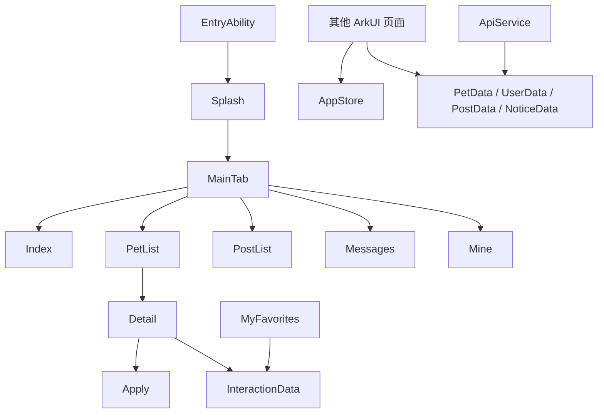

# 工程架构与数据边界

`EntryAbility` 在窗口创建时加载 `pages/Splash`，随后由 `RouterHelper` 跳转登录或 `MainTab`。`MainTab` 装配首页、宠物列表、社区、消息和个人中心五个页签。页面使用 ArkUI 组件及 `@State` 控制局部显示状态，路由封装在 `router/RouterHelper.ets`。

源码位置：[`EntryAbility`](../entry/src/main/ets/entryability/EntryAbility.ets)、[`MainTab`](../entry/src/main/ets/pages/MainTab.ets)、[`RouterHelper`](../entry/src/main/ets/router/RouterHelper.ets)、[`AppStore`](../entry/src/main/ets/store/AppStore.ets)、[`ApiService`](../entry/src/main/ets/services/ApiService.ets)。

## 数据如何流动

- `mock/PetData.ets` 提供宠物列表与详情；`mock/InteractionData.ets` 管理用户与宠物的点赞、收藏和浏览示例记录。
- `pages/Detail.ets` 和 `pages/MyFavorites.ets` 应共享同一份收藏记录。记录是进程内数据，关闭应用后不保证保留。
- `AppStore` 为其他页面提供全局状态；其用户和主题“持久化”方法目前没有实际存储实现，不能描述为本地持久化。
- `ApiService` 用定时延迟模拟异步请求，内部仍调用 Mock 函数；没有实际 HTTP 接口。
- `services/RecommendationService.ets` 实现基于偏好与互动的规则打分；`pages/SmartRecommendation.ets` 的演示结果另有随机逻辑，尚未形成可验证的线上推荐链路。

## 边界与待改进处

`ARPreview.ets` 以图片变换模拟预览；`PetLostWarning.ets` 以本地随机位置模拟告警。两个模块都没有真实硬件接入，
AI 推荐、AR、IoT 均为 Mock/演示，没有真实模型、AR 引擎或设备。成长档案部分按钮已明确标示为演示，未保存记录。
申请和收藏数据均为内存 Mock，不是服务端持久化，跨重启不保证保留。
工程已在当前环境完成 ArkTS 编译和未签名 HAP 打包，并于 2026-10-15 在 OpenHarmony 6.0.2.130 模拟器上安装启动，
检查了首页、列表、详情、收藏/取消、我的收藏、领养申请、社区和个人中心；收藏及个人中心计数 2→1→2 的设备复测通过，
领养申请提交后“我的申请”新增第 4 条待审核 Mock 记录、相关计数从 3 变 4。以上仅是模拟器、内存 Mock 证据，
不是物理真机、线上后端或跨重启持久化证据；构建仍有 ArkTS 警告、产物未签名。
